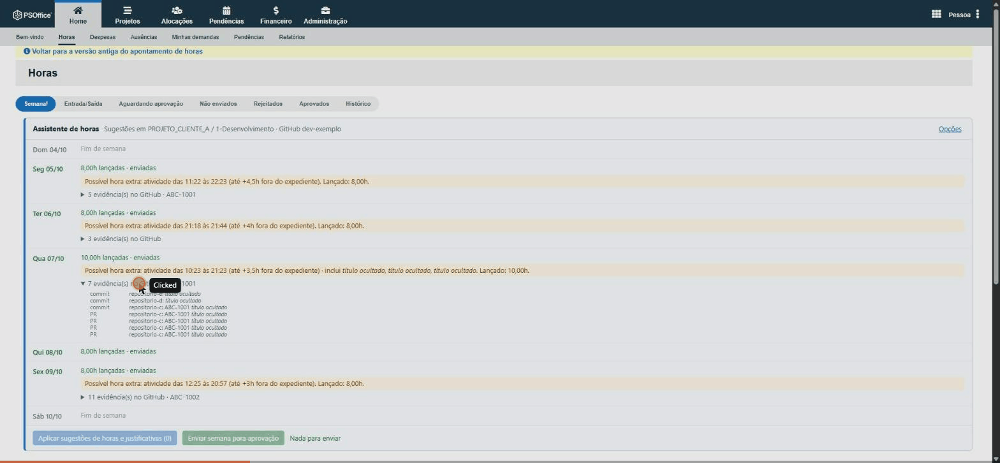
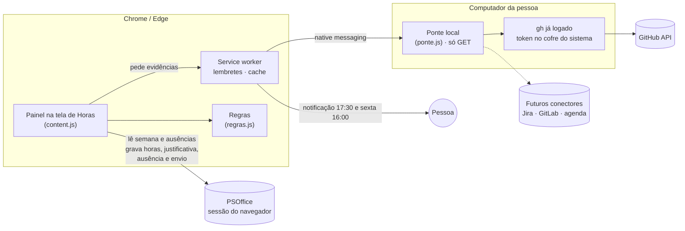
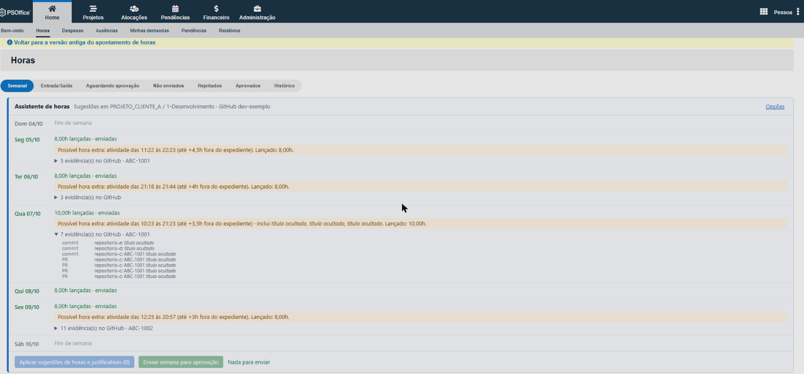
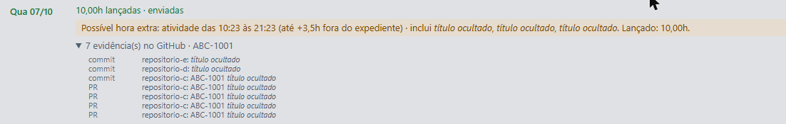
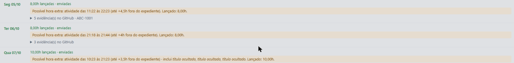
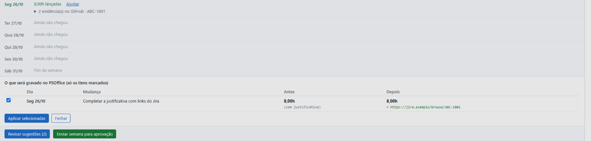
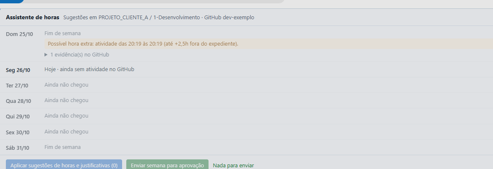
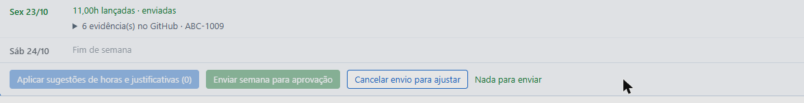

# Assistente de Horas PSOffice

Hackathon Ideen 2026 · Desafio 3 (Automação de controles internos) · controle **1. Horas não lançadas**, resolvido do lado de quem lança.



## 1. O problema

Quem esquece de lançar horas no PSOffice reconstrói a semana de memória, precisa justificar ao cliente onde atuou, deixa ausência como dia zerado para alguém cobrar depois e ainda precisa lembrar de selecionar as atividades na segunda e de enviar a semana na sexta.

## 2. O que eu fiz

Uma extensão do Chrome/Edge que aparece **dentro da tela de Horas do PSOffice**, cruza o que está lançado com a atividade da pessoa no GitHub e transforma a regra do controle em ação: lembra, sugere e preenche. Horas, justificativas, ausências e envio só são gravados com um clique de confirmação; a única ação automática é repetir as atividades da semana anterior quando a semana começa vazia (dá para desligar nas opções).



| Dor | O que o assistente faz |
|---|---|
| Esquecer de lançar | Notificação diária (17:30) só quando há dia útil sem horas e sem ausência |
| Retroativo sem contexto | Para cada dia, sugere 8h e a **justificativa com os links do Jira** das demandas em que você é autor (seus commits, pushes, branches e PRs que você abriu), no formato que já se usa no PSOffice. Revisões, comentários e PRs de outras pessoas aparecem no painel como colaboração, mas não entram na justificativa |
| Hora extra (deploy em PRD, plantão) | Estima o tempo fora do expediente por sessões de atividade, com peso menor para colaboração (um review isolado vale 0,25h), e destaca itens `[PRD]`/`hotfix`; se o lançado já cobre, só informa; nunca grava sozinho |
| Saber o que a sugestão muda | **Revisar sugestões** lista, por dia, o antes → depois (horas e justificativa, com as linhas novas destacadas) e grava só os itens marcados. Vale também para semana salva e não enviada: completa links do Jira que faltam e oferece a hora extra, desmarcada por ser estimativa. Quando um botão está desligado, o painel diz por quê |
| Corrigir antes da aprovação | Dia lançado e não enviado ganha **Ajustar** (horas e justificativa); semana enviada e não aprovada ganha **Cancelar envio para ajustar** |
| Ausência como dia zerado | Dia útil passado sem horas e sem nenhuma atividade vira sugestão de **ausência**, registrada no formulário oficial |
| Ausência com trabalho no dia | Avisa quando há ausência registrada mas houve atividade no GitHub |
| Segunda sem atividades | Repete automaticamente as atividades da semana anterior |
| Enviar no fim da semana | Lembrete na sexta (16:00) e botão **Enviar semana para aprovação**, com resumo para confirmar |

**Regra de exceção:** a do kit (dia útil sem nenhum lançamento, sem fim de semana e feriado; pendente conta como lançado), mais: ausência registrada não é pendência; o dia de hoje sem atividade ainda não é ausência; dia sem lançamento **com** atividade vira sugestão de horas; **sem** atividade vira sugestão de ausência; atividade fora do expediente (08:00–18:00; em fim de semana e feriado, o dia todo) vira indício de hora extra, agrupada em sessões: eventos até 60 min um do outro formam uma sessão; sessão com trabalho próprio vale do primeiro ao último evento mais 30 min, e sessão só de colaboração (revisão, comentário) vale metade do intervalo mais 15 min; o total é arredondado em 0,25h. A sugestão compara com o já lançado (jornada + indício; em fim de semana, só o indício) e só aparece se faltar hora, sempre desmarcada.

**Sem senha e sem token na extensão.** O PSOffice é acessado com a sessão já aberta no navegador, reproduzindo as mesmas chamadas das telas (`/api/horas/apontamento`, justificativa, seleção de atividades, ausência, envio e cancelamento). O GitHub é lido por uma **ponte local** que usa o `gh` já logado: o token não sai do cofre do sistema e a ponte só aceita `GET` em `/user`, `/users/<você>/events`, `/search/issues` e `/search/commits`. Para o PSOffice vão só links do Jira; títulos de PR/commit do cliente só com opção ligada. Cada gravação é conferida relendo o PSOffice.

## 3. Como reproduzir

Requer Node 18+. Para o uso real, também Chrome ou Edge e o [GitHub CLI](https://cli.github.com/) logado.

### A regra com a massa fictícia do kit (1 minuto)

```bash
node kit/verificar-kit.js
node kit/testar.js
```

O primeiro aplica a regra (o mesmo `extensao/lib/regras.js` da extensão) em `dados/horas/*.csv`, grava `evidencias/dias_sem_lancamento.csv` e compara com o esperado do kit. O segundo roda os testes das regras, da ponte e dos formulários.

### O assistente no dia a dia (3 passos)

1. **Ponte do GitHub**, num terminal comum (no Windows: Iniciar > Terminal; terminais embutidos em apps empacotados não servem, e o instalador avisa):

   ```bash
   node extensao/ponte/instalar.js --usuario <sua-conta-do-gh>
   ```

   Registra só para o seu usuário, sem admin, e termina com `Teste ok`. Para desfazer: `--remover`.
2. **Extensão**: em `chrome://extensions`, ligue o *Modo do desenvolvedor* e use *Carregar sem compactação* na pasta `extensao/`. As opções abrem e mostram `Ponte ok`.
3. **Uso**: abra *Horas* no PSOffice. O painel aparece acima da grade semanal.

Sem a ponte, a extensão continua funcionando (lembretes, atividades, ausência e envio), só sem as sugestões vindas do GitHub.

### Novos conectores

Hoje a fonte de atividade é o GitHub, o que atende quem desenvolve. Para outros perfis, a ponte já junta evidências de uma lista de conectores (`CONECTORES` em `extensao/ponte/ponte.js`): cada um recebe o período e devolve `{ porDia: { 'AAAA-MM-DD': [{ ts, fonte, repo, texto, url }] } }`, com a sua própria lista de leituras permitidas. Candidatos naturais: Jira (issues e worklogs), GitLab/Azure DevOps, agenda (Google/Outlook) e Teams/Slack.

## 4. Evidências

O GIF do topo, passo a passo, com telas reais do uso (semanas de 04 a 26/10). Os quadros são da evolução da extensão nesses dias: nos passos 1 e 6 o botão ainda se chamava "Aplicar sugestões" (hoje "Revisar sugestões"); nos passos 1 a 3 o aviso de hora extra ainda usava a estimativa anterior ("até +Xh", erro 13 da seção 5); nos passos 4 e 5 a linha de domingo foi retirada do quadro porque mostrava a estimativa de hora extra de fim de semana anterior à correção (erro 12 da seção 5). Nome, projeto, conta, repositórios, títulos e chaves do Jira estão **mascarados**.

| Passo | Tela |
|---|---|
| 1. O painel aparece em cima da grade de Horas do PSOffice |  |
| 2. Cada dia mostra o que foi feito: PRs, commits e chaves do Jira |  |
| 3. Atividade fora do expediente vira aviso de possível hora extra |  |
| 4. Revisar sugestões: veja o antes → depois e grave só o que marcar |  |
| 5. Semana atual: hoje sem atividade ainda não conta como ausência |  |
| 6. Semana enviada e não aprovada: cancelar o envio para ajustar |  |

Como gerar de novo: com o painel carregado, cole `kit/anonimizar-tela.js` no console (F12) e tire os prints; depois `python kit/montar-gif.py evidencias/prints/quadros evidencias/prints/assistente-horas-demo.gif` monta o GIF com as legendas (requer Pillow). O script de máscara não contém dado real: descobre na página o que esconder.

- `evidencias/log-verificacao-kit.txt` e `evidencias/dias_sem_lancamento.csv`: regra do kit **idêntica ao esperado (61 linhas)**; rodar de novo gera o mesmo arquivo.
- `evidencias/log-testes.txt`: 20 testes passando.
- No PSOffice real (só na conta do autor, com autorização): leitura de semanas, ausências e justificativas; regravação de horas e justificativa conferida; seleção automática das atividades da semana seguinte; envio de uma semana para aprovação. Os formulários de ausência, atividades e envio foram comparados campo a campo com o que o navegador envia.

## 5. Onde a IA errou

1. **Propôs um mock do PSOffice.** O pedido era usar de verdade a partir de segunda; virou integração real pela sessão, e a massa fictícia ficou para validar a regra.
2. **Usou a URL da semana dos links da tela** (`ExibeSemanal`), que sem `usuId` devolve "Acesso Negado" com HTTP 200. Trocada por `Select&dtRef` e criada a detecção de página de erro.
3. **Assumiu que a API de eventos do GitHub traz título de PR e commits.** Não traz mais; os títulos vêm da busca de PRs.
4. **Serializador de formulário com regex ingênua**: um `<input>` engolia os campos seguintes, e o HTML real tem aspas sobrando e `>` dentro de atributo. Os testes reais tinham passado por sorte; o teste unitário e a comparação com o navegador pegaram.
5. **Estimou hora extra pelo intervalo do dia**, o que superestimava (12h sugeridas para um dia de 10h). Virou aviso com teto e botão.
6. **Leu as telas como UTF-8**; são `windows-1252`.
7. **Mandou colar o token do `gh` na extensão**, criando cópia de um token de cliente com escrita. Trocado pela ponte local, só leitura.
8. **Instalou a ponte de dentro do app desktop do Claude** e declarou pronta: o app é empacotado (MSIX) e o Windows escondeu do Chrome o registro e os arquivos. O instalador agora detecta e pede um terminal comum.
9. **A primeira máscara de prints deixou o sobrenome**: trocou o primeiro nome antes do nome completo. Pego ao revisar o print, antes de salvar; agora troca do mais longo para o mais curto e confere se sobrou dado real. Essa conferência pegou um segundo caso: o painel terminava de carregar depois da máscara e trazia o nome do projeto; o script passou a ler o projeto também do cabeçalho do painel.
10. **Sugeria ausência para o dia de hoje** antes de qualquer atividade. Hoje sem atividade não é pendência.
11. **O primeiro GIF era pouco claro**: página inteira reduzida, 4 quadros e nada dizendo o que olhar. Refeito em passos legendados, com recortes ampliados e tempo de leitura (`kit/montar-gif.py`).
12. **Estimava hora extra de fim de semana a partir das 18:00**: um único evento às 20:19 de um domingo virava +2,5h. Pego no uso real; fora de dia útil, conta o intervalo da própria atividade.
13. **A estimativa de hora extra ainda era agressiva**: contava do fim do expediente até o último evento e somava por cima do já lançado (um review de 30 min no domingo, com 1h lançada, virava 1,5h). Agora agrupa a atividade em sessões e compara com o lançado; na calibração com o histórico real, dias como 22/10 (10h lançadas, antes "até +4h") passaram a "já coberto".

## Como a IA foi usada

Todo o desenvolvimento foi feito em par com o **Claude Code** (app desktop, aba Code), usando o modelo **Claude Opus 5.5 com esforço Alto**, em uma única sessão de 23 a 26/10/2026.

| Etapa | O que a IA fez | O que a pessoa decidiu ou validou |
|---|---|---|
| Entendimento | Leu o kit e os slides; explorou o PSOffice só lendo (navegador embutido, com o login feito pela pessoa) e mapeou telas, endpoints e formulários | Escolheu a dor (horas não lançadas) e pediu algo usável de verdade, sem mock |
| Construção | Escreveu a extensão, a ponte local, as regras, os testes e o instalador | Trocou o token na extensão pela ponte com o `gh`, por causa do monitoramento de tokens do cliente; pediu só links do Jira na justificativa e só das demandas de autoria (revisão e comentário não justificam horas, só pesam pouco na hora extra) |
| Validação | Rodou testes, a regra contra o esperado do kit e comparou cada formulário com o que o navegador envia; testou no PSOffice real | Autorizou, uma a uma, as gravações reais (atividades, regravação de horas, envio da semana) e conferiu no Chrome (Claude in Chrome) |
| Evidências | Criou a máscara de dados, capturou prints e montou o GIF | Pediu evidências mais claras, a revisão de sugestões e o repositório público sem dados sensíveis |

Ferramentas usadas pela IA: terminal, edição de arquivos, navegador embutido do app, Claude in Chrome e o `gh` da pessoa. Os erros da IA e as correções estão na seção 5.

## Premissas do desafio

| Premissa (slides e kit) | Como foi atendida |
|---|---|
| Projeto individual, um repositório `hackathon-2026-d3-<usuário>` | Este repositório, na conta pessoal do autor (alinhado com a organização em vez de `ideen-tech`) |
| Só dados fictícios; nada de dado de cliente ou de colaborador | A regra é validada com a massa fictícia do kit. As telas do uso real só aparecem **mascaradas** (pessoa, projeto, conta, repositórios, títulos, chaves e links do Jira) |
| Nenhuma senha, chave ou token real em código, prompt ou tela | Sessão do navegador para o PSOffice e `gh` para o GitHub; nada é guardado. O campo `key` do `manifest.json` é uma chave **pública**, só fixa o ID da extensão |
| Código de projeto de cliente fica fora | Do GitHub só se leem metadados; nenhum código de cliente no repositório |
| Tudo roda na máquina; nuvem não é necessária | Extensão, ponte e scripts rodam localmente |
| Teste só com você mesmo; nenhuma mensagem para outras pessoas | Todas as gravações reais foram na conta do autor, com autorização dele; a extensão não envia e-mail nem mensagem |
| Entrega: solução, `evidencias/` (prints, saída e log) e README com os 5 itens | Seções 1 a 5 acima; `evidencias/` com GIF, quadros, saída e logs |
| Bônus: roda sozinha, não duplica e vídeo curto | Lembretes e seleção de atividades por alarme; as sugestões só listam o que ainda falta (aplicar de novo não repete nada) e a regra do kit gera o mesmo arquivo a cada execução; GIF de demonstração |
| Reaproveitável com a planilha real | `node kit/verificar-kit.js <pasta> <inicio> <fim>` aceita outros CSVs e períodos sem mudar a lógica |

## Limitações

- Útil para quem tem histórico consistente no Git; outros perfis dependem de novos conectores.
- A busca de commits só vê a branch padrão; além dos ~300 eventos recentes (1 a 2 semanas) as evidências ficam mais pobres.
- Uma só atividade recebe a sugestão (a configurada ou a com mais horas na semana).
- Se a JExperts mudar as telas, o painel avisa "a tela do PSOffice mudou?" em vez de gravar errado. A integração oficial seria o web service SOAP do PSOffice, que exige liberação da administração.

## Dados e segurança

Nenhum token, senha ou dado de cliente no repositório; a massa é a fictícia do kit (`KIT.md` é o README original do kit; slides e planilha ficaram de fora). Do GitHub só são lidos metadados, nunca código. As chamadas aparecem como uso do GitHub CLI da própria pessoa; se o cliente restringir automações pessoais com a credencial dele, confirme antes com a segurança do cliente.
