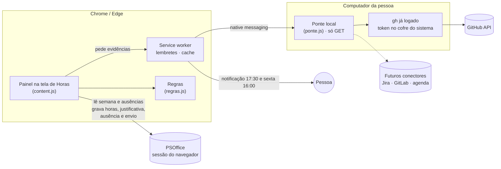
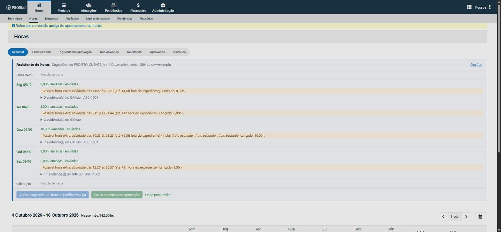
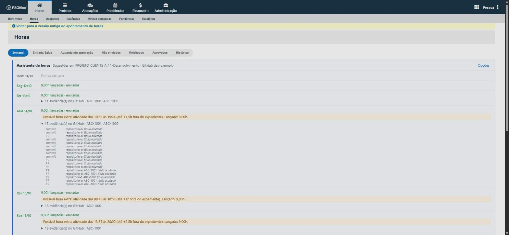
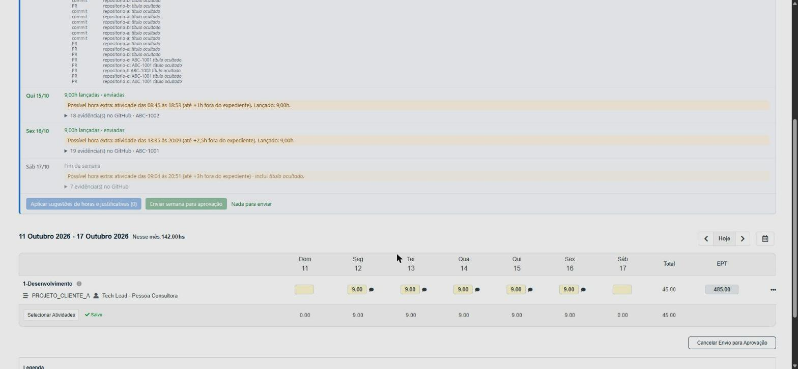

# Assistente de Horas PSOffice

Hackathon Ideen 2026 · Desafio 3 (Automação de controles internos) · controle **1. Horas não lançadas**, resolvido do lado de quem lança.


## 1. O problema

Quem esquece de lançar horas no PSOffice reconstrói a semana de memória, precisa justificar ao cliente onde atuou, deixa ausência como dia zerado para alguém cobrar depois e ainda precisa lembrar de selecionar as atividades na segunda e de enviar a semana na sexta.

## 2. O que eu fiz

Uma extensão do Chrome/Edge que aparece **dentro da tela de Horas do PSOffice**, cruza o que está lançado com a atividade da pessoa no GitHub e transforma a regra do controle em ação: lembra, sugere e preenche, sempre com um clique de confirmação.



| Dor | O que o assistente faz |
|---|---|
| Esquecer de lançar | Notificação diária (17:30) só quando há dia útil sem horas e sem ausência |
| Retroativo sem contexto | Para cada dia, sugere 8h e a **justificativa com os links do Jira** tirados de branches, PRs e commits do dia (o formato que já se usa no PSOffice) |
| Hora extra (deploy em PRD, plantão) | Mostra atividade fora do expediente e itens `[PRD]`/`hotfix`, com botão `+Xh`; nunca soma sozinho |
| Corrigir antes da aprovação | Dia lançado e não enviado ganha **Ajustar** (horas e justificativa); semana enviada e não aprovada ganha **Cancelar envio para ajustar** |
| Ausência como dia zerado | Dia útil passado sem horas e sem nenhuma atividade vira sugestão de **ausência**, registrada no formulário oficial |
| Ausência com trabalho no dia | Avisa quando há ausência registrada mas houve atividade no GitHub |
| Segunda sem atividades | Repete automaticamente as atividades da semana anterior |
| Enviar no fim da semana | Lembrete na sexta (16:00) e botão **Enviar semana para aprovação**, com resumo para confirmar |

**Regra de exceção:** a do kit (dia útil sem nenhum lançamento, sem fim de semana e feriado; pendente conta como lançado), mais: ausência registrada não é pendência; o dia de hoje sem atividade ainda não é ausência; dia sem lançamento **com** atividade vira sugestão de horas; **sem** atividade vira sugestão de ausência; atividade fora do expediente (08:00–18:00) vira aviso de hora extra com teto arredondado em 0,5h.

**Sem senha e sem token na extensão.** O PSOffice é acessado com a sessão já aberta no navegador, reproduzindo as mesmas chamadas das telas (`/api/horas/apontamento`, justificativa, seleção de atividades, ausência, envio e cancelamento). O GitHub é lido por uma **ponte local** que usa o `gh` já logado: o token não sai do cofre do sistema e a ponte só aceita `GET` em `/user`, `/users/<você>/events`, `/search/issues` e `/search/commits`. Para o PSOffice vão só links do Jira; títulos de PR/commit do cliente só com opção ligada. Cada gravação é conferida relendo o PSOffice.

## 3. Como reproduzir

Requer Node 18+. Para o uso real, também Chrome ou Edge e o [GitHub CLI](https://cli.github.com/) logado.

### A regra com a massa fictícia do kit (1 minuto)

```bash
node kit/verificar-kit.js
node kit/testar.js
```

O primeiro aplica a regra (o mesmo `extensao/lib/regras.js` da extensão) em `dados/horas/*.csv`, grava `evidencias/dias_sem_lancamento.csv` e compara com o esperado do kit. O segundo roda os testes das regras, da ponte e dos formulários.

### O assistente no dia a dia (3 passos)

1. **Ponte do GitHub**, num terminal comum (no Windows: Iniciar > Terminal; terminais embutidos em apps empacotados não servem, e o instalador avisa):

   ```bash
   node extensao/ponte/instalar.js --usuario <sua-conta-do-gh>
   ```

   Registra só para o seu usuário, sem admin, e termina com `Teste ok`. Para desfazer: `--remover`.
2. **Extensão**: em `chrome://extensions`, ligue o *Modo do desenvolvedor* e use *Carregar sem compactação* na pasta `extensao/`. As opções abrem e mostram `Ponte ok`.
3. **Uso**: abra *Horas* no PSOffice. O painel aparece acima da grade semanal.

Sem a ponte, a extensão continua funcionando (lembretes, atividades, ausência e envio), só sem as sugestões vindas do GitHub.

### Novos conectores

Hoje a fonte de atividade é o GitHub, o que atende quem desenvolve. Para outros perfis, a ponte já junta evidências de uma lista de conectores (`CONECTORES` em `extensao/ponte/ponte.js`): cada um recebe o período e devolve `{ porDia: { 'AAAA-MM-DD': [{ ts, fonte, repo, texto, url }] } }`, com a sua própria lista de leituras permitidas. Candidatos naturais: Jira (issues e worklogs), GitLab/Azure DevOps, agenda (Google/Outlook) e Teams/Slack.

## 4. Evidências

Prints e GIF do uso real, com nome, projeto, conta, repositórios, títulos e chaves do Jira **mascarados** por `kit/anonimizar-tela.js` (genérico: descobre na página o que esconder, sem conter dado real).

| Semana 04–10/10 | Semana 11–17/10 | Semana 11–17/10 (fim) |
|---|---|---|
|  |  |  |
| Dias de 8h e 10h, avisos de hora extra e um dia sem evidência | Evidências de um dia: tipo, repositório e chave do Jira | Hora extra no sábado e a grade do PSOffice |

- `evidencias/log-verificacao-kit.txt` e `evidencias/dias_sem_lancamento.csv`: regra do kit **idêntica ao esperado (61 linhas)**; rodar de novo gera o mesmo arquivo.
- `evidencias/log-testes.txt`: 15 testes passando.
- No PSOffice real (só na conta do autor, com autorização): leitura de semanas, ausências e justificativas; regravação de horas e justificativa conferida; seleção automática das atividades da semana seguinte; envio de uma semana para aprovação. Os formulários de ausência, atividades e envio foram comparados campo a campo com o que o navegador envia.

## 5. Onde a IA errou

1. **Propôs um mock do PSOffice.** O pedido era usar de verdade a partir de segunda; virou integração real pela sessão, e a massa fictícia ficou para validar a regra.
2. **Usou a URL da semana dos links da tela** (`ExibeSemanal`), que sem `usuId` devolve "Acesso Negado" com HTTP 200. Trocada por `Select&dtRef` e criada a detecção de página de erro.
3. **Assumiu que a API de eventos do GitHub traz título de PR e commits.** Não traz mais; os títulos vêm da busca de PRs.
4. **Serializador de formulário com regex ingênua**: um `<input>` engolia os campos seguintes, e o HTML real tem aspas sobrando e `>` dentro de atributo. Os testes reais tinham passado por sorte; o teste unitário e a comparação com o navegador pegaram.
5. **Estimou hora extra pelo intervalo do dia**, o que superestimava (12h sugeridas para um dia de 10h). Virou aviso com teto e botão.
6. **Leu as telas como UTF-8**; são `windows-1252`.
7. **Mandou colar o token do `gh` na extensão**, criando cópia de um token de cliente com escrita. Trocado pela ponte local, só leitura.
8. **Instalou a ponte de dentro do app desktop do Claude** e declarou pronta: o app é empacotado (MSIX) e o Windows escondeu do Chrome o registro e os arquivos. O instalador agora detecta e pede um terminal comum.
9. **A primeira máscara de prints deixou o sobrenome**: trocou o primeiro nome antes do nome completo. Pego ao revisar o print, antes de salvar; agora troca do mais longo para o mais curto e confere se sobrou dado real.
10. **Sugeria ausência para o dia de hoje** antes de qualquer atividade. Hoje sem atividade não é pendência.

## Limitações

- Útil para quem tem histórico consistente no Git; outros perfis dependem de novos conectores.
- A busca de commits só vê a branch padrão; além dos ~300 eventos recentes (1 a 2 semanas) as evidências ficam mais pobres.
- Uma só atividade recebe a sugestão (a configurada ou a com mais horas na semana).
- Se a JExperts mudar as telas, o painel avisa "a tela do PSOffice mudou?" em vez de gravar errado. A integração oficial seria o web service SOAP do PSOffice, que exige liberação da administração.

## Dados e segurança

Nenhum token, senha ou dado de cliente no repositório; a massa é a fictícia do kit (`KIT.md` é o README original do kit; slides e planilha ficaram de fora). Do GitHub só são lidos metadados, nunca código. As chamadas aparecem como uso do GitHub CLI da própria pessoa; se o cliente restringir automações pessoais com a credencial dele, confirme antes com a segurança do cliente.
